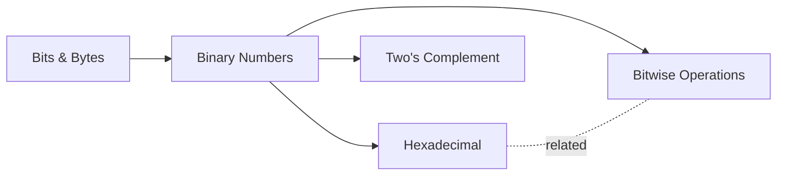

# Adding a subject to Cognexa

Cognexa is built so that a new subject is a **content pack**, not a code change. Every concept, chunk, question, mastery row and chat thread carries a `subject_id`, and the graph, tutor pipeline, quiz engine and recommender read whatever subject they are given. This guide walks through creating a pack, validating it, seeding it and checking it in the product. It uses the 5-concept demo pack in [`data/subjects/_example/`](../data/subjects/_example/) (Number Systems) as the worked example. Every command below was run on that pack.

> **Demo packs vs real packs.** A folder whose name starts with `_` is a *demo pack*. The loader serves `data/subjects/_example/` as subject id `example`. Seed scripts refuse to send a demo pack to a remote database (even with `--allow-remote`), and the API's Docker image leaves `data/subjects/_*` out, so it never reaches production. A real subject lives in `data/subjects/<id>/` without the underscore.

---

## 1. Plan the concept graph

Before writing anything, list the concepts (5-80 is a good range) and decide, for each one, what a student must already know. Write that as prerequisite edges.

- **Edge direction (CLAUDE.md rule 4):** `prerequisites: [A]` on concept B means `(A)-[:PREREQUISITE_OF]->(B)`: *A must be learned before B*.
- The prerequisite graph must be a **DAG** (no cycles). The validator and the admin edge editor both refuse cycles.
- `related` links are associative, undirected and optional. Do not add a related link between two concepts that already have a prerequisite edge (the validator refuses the duplicate).
- Group concepts into a few **clusters** (for example `representation` and `operations` in the demo).

The demo graph:



## 2. Create the folder

```
data/subjects/<id>/
├── concepts.yaml               # the graph: nodes + edges (source of truth)
├── content/<concept_id>.md     # one note per concept (10 fixed sections)
├── questions/<concept_id>.yaml # at least 8 questions per concept
├── questions/_study_sets.yaml  # optional: pre/post-test forms for a user study
└── eval/testset.jsonl          # optional for a demo; 80+ items for a real evaluation
```

`<id>` must match `^[a-z][a-z0-9_]{0,63}$` (lowercase, starts with a letter).

## 3. Write `concepts.yaml`

See [`data/subjects/_example/concepts.yaml`](../data/subjects/_example/concepts.yaml). Each concept needs:

| Field | Meaning |
|---|---|
| `id` | lowercase id, unique in the subject |
| `name` | display name (notes' frontmatter must repeat it exactly) |
| `cluster` | group name |
| `order_index` | teaching order (a topological order; see below) |
| `difficulty` | 1-3 |
| `description` | one or two sentences (used by the classifier catalogue and embeddings) |
| `aliases`, `keywords` | what students actually type. **These drive question → concept matching**, especially for questions that never name the concept. Include symptom words (for two's complement: `"-128"`, `overflow`, `goes negative`). |
| `prerequisites`, `related` | edges, as above |

Quote YAML values that start with `& * ! | > @` (for example `"&"`), or the file will not parse.

Compute `order_index` and validate:

```bash
uv run --project apps/api python scripts/assign_order_index.py example   # writes order_index (--check only reports)
uv run --project apps/api python scripts/validate_graph.py example
# Subject: example (Number Systems (demo pack))
# Nodes: 5
# Edges: 4 PREREQUISITE_OF, 1 RELATED_TO ...
# OK: graph is valid.
```

## 4. Write one note per concept

`content/<concept_id>.md` has YAML frontmatter (`id`, `name`, `cluster`, `reviewed: false`, `sources`) and exactly these ten `##` sections, in this order. Each section becomes one retrievable chunk:

1. Overview · 2. Intuition · 3. How It Works · 4. Worked Example · 5. Code · 6. Complexity · 7. Common Mistakes & Misconceptions · 8. Builds On · 9. Leads To · 10. Check Yourself

Rules the validator enforces:

- 450-1600 words (600-1200 is the target).
- **Code** has a ```` ```python ```` block and a ```` ```cpp ```` block (C++14). Each one is a complete program that asserts its own claims; the snippet runner executes them.
- **Builds On** mentions every prerequisite by name (a root concept says it has no prerequisites). **Leads To** mentions at least one concept that depends on it.
- **Check Yourself** has exactly three `**Q1.**` / `**A1.**` pairs.
- No unfinished or self-correcting text ("TODO", "wait, ...").

## 5. Write questions

`questions/<concept_id>.yaml`: at least 8 questions per concept, with at least 4 `mcq`, 1 `multi_select`, 1 `true_false`, 1 `code_output` and 1 `short_answer`. See [`questions/twos_complement.yaml`](../data/subjects/_example/questions/twos_complement.yaml).

- Ids look like `<concept_id>-q01`.
- Every wrong option has a `why_wrong` (the misconception it targets).
- `code_output` answers are checked against the real output of the code.
- `short_answer` questions have a `rubric` with `key_points`; the LLM judge grades against them.
- `diagnoses_prereq` (optional) names an ancestor concept that a wrong answer points to; the mastery model and recommender use it.

## 6. (Optional) Evaluation test set and study forms

- `eval/testset.jsonl`: one JSON object per line with `id`, `question`, `category` (`direct`, `unnamed_prerequisite`, `multi_concept`, `misconception`, `off_topic`), `gold_concepts`, `gold_prerequisites`, `reference_answer`. For `unnamed_prerequisite` items the validator checks that the prerequisite really is an ancestor and is **not** named in the question. The demo has 5 items; a real evaluation needs 80+ with the category minimums (`--strict`).
- `questions/_study_sets.yaml`: two matched forms (`pretest_A`, `posttest_B`). Their questions are kept out of practice quizzes (DEC-068).

## 7. Validate everything

```bash
uv run --project apps/api python scripts/validate_content.py --subject example
# ... Notes: 5/5 · question files: 5/5 (40 questions) · testset items: 5
# OK: content is valid (non-strict: pending allowed)
uv run --project apps/api python scripts/run_content_snippets.py --subject example
# 10 passed, 0 failed, 0 skipped, of 10 snippets
# 5 of 5 code_output questions match their answer
```

Use `--strict` for a real subject: it also requires study sets and a full test set. Add a test like `tests/test_content_real.py::test_demo_subject_pack_is_complete_and_correct` so CI keeps the pack valid.

## 8. Seed it (dev first)

```bash
docker compose up -d        # local Neo4j + Postgres
uv run --project apps/api python scripts/seed_neo4j.py --subject example
# Seeded subject 'example': 5 concepts, 4 PREREQUISITE_OF, 1 RELATED_TO; 50 chunks
uv run --project apps/api python scripts/seed_postgres.py --subject example
# Seeded Postgres: subject 'example', 5 concepts, ... 50 chunks, 40 questions
uv run --project apps/api python scripts/seed_vectors.py
# Embedded 50 chunk(s) ...
```

Seeding is idempotent: run it again after every content change. A real subject goes to production the same way with `--allow-remote` and `COGNEXA_ENV_FILE=apps/api/.env.production` (docs/DEPLOYMENT.md §3.2). A demo pack is refused:

```
$ uv run --project apps/api python scripts/seed_neo4j.py --subject example --allow-remote
Refusing to seed demo subject 'example' remotely: demo packs are dev-only.
```

The API caches the concept catalogue for 5 minutes; restart the dev API (or wait) to see new aliases.

## 9. Check it in the product

Everything below takes a `subject_id` parameter. Verified on dev with the demo pack:

| Check | Request | Result on the demo |
|---|---|---|
| Graph | `GET /graph?subject_id=example` | 5 nodes, 5 edges |
| Concepts | `GET /concepts?subject_id=example` | the 5 concepts in teaching order |
| Tutor | `POST /tutor/threads {"subject_id": "example"}`, then ask "My 8-bit counter goes from 127 straight to -128 when I add one. Why?" | matched `twos_complement` (and `bits_bytes`); the traversal adds the prerequisite `binary_numbers`; 10 chunks in context |
| Quiz | `POST /quiz/sessions {"mode": "concept", "subject_id": "example", "concept_id": "twos_complement"}` | 201 with the concept's questions |

The tutor result is the product's central idea in a new subject: the question never says "binary", yet the graph walk brings in Binary Numbers as the prerequisite to explain.

## 10. What is still DSA-specific (LIM-045)

The data model, seeds, graph, tutor pipeline, quiz engine, mastery model and recommender are subject-agnostic. Three things are not yet:

1. **Prompt wording.** The tutor, revision-sheet, edge-suggestion and tagging prompts and the refusal messages say "Data Structures & Algorithms". For a second real subject, take the subject name from the `subjects` table and put it into those templates.
2. **Web subject choice.** The web app always uses the API's default subject (`dsa`); there is no subject picker. Add a subject switcher (stored on the profile) that passes `subject_id` to the calls above.
3. **Onboarding diagnostic clusters.** `app/quiz/selection.py` lists the DSA clusters for the 10-question diagnostic. Move the list into `concepts.yaml` (for example a `diagnostic_clusters` field).

None of these affects how content is stored or retrieved, so a new pack written today keeps working when they are generalised.
