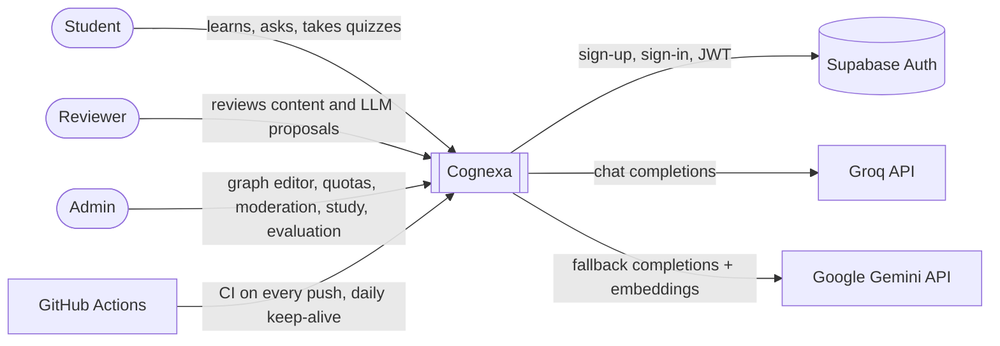
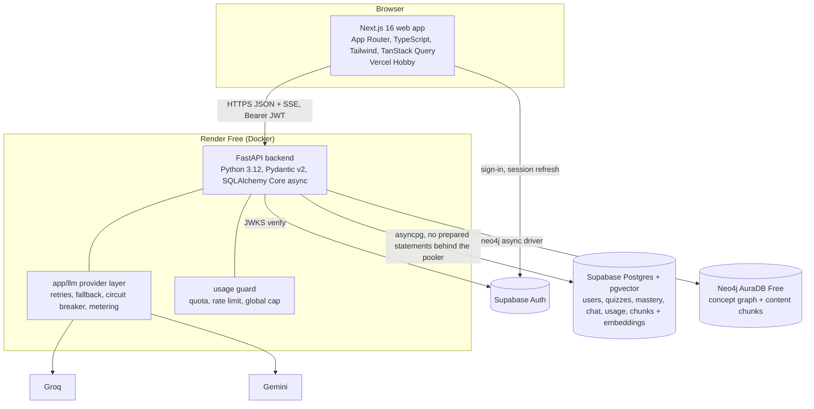
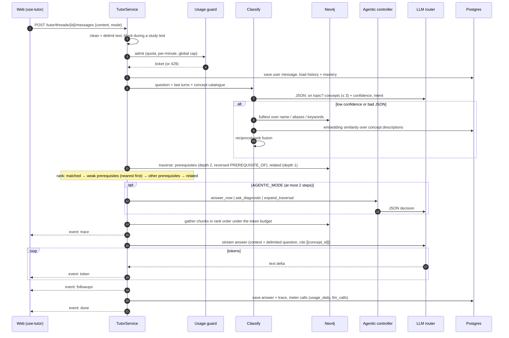
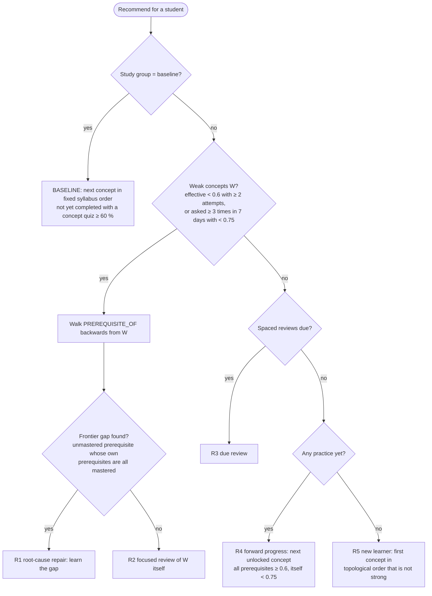
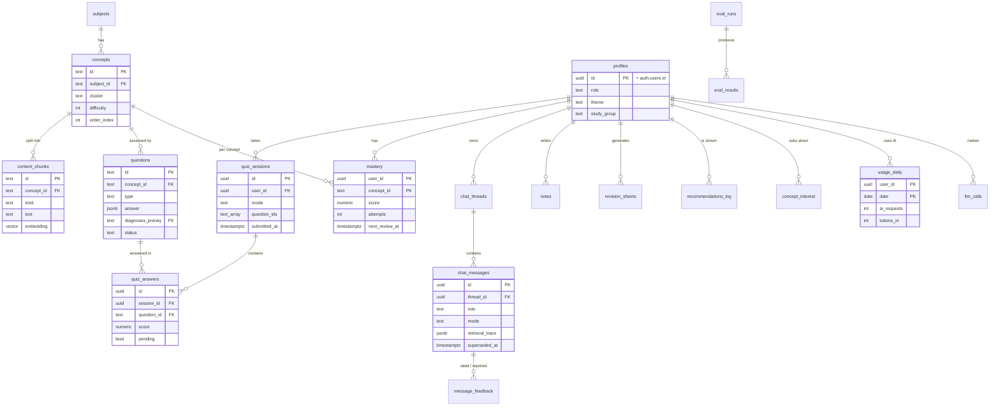
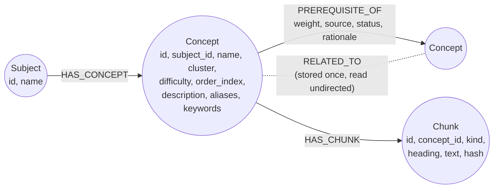
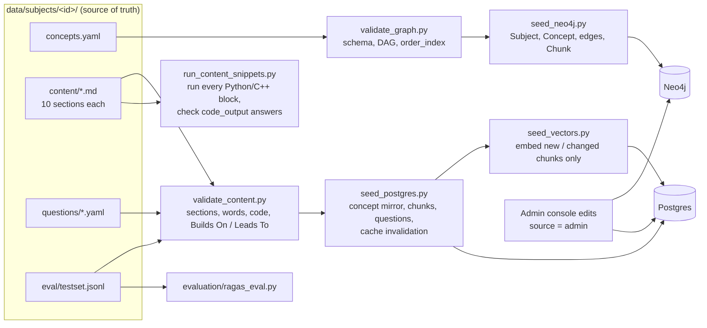

# Cognexa architecture

> Written for: the project team, examiners and future maintainers. The diagrams are Mermaid (GitHub renders them). Decisions are referenced by their id in the Decisions Log (`progressfile.md` §8), for example DEC-004.

**Contents:** [1. System context](#1-system-context) · [2. Containers](#2-containers) · [3. The GraphRAG pipeline](#3-the-graphrag-pipeline) · [4. The recommender](#4-the-recommender-r1-r5) · [5. Postgres data model](#5-postgres-data-model) · [6. Neo4j schema](#6-neo4j-schema) · [7. Content and seeding flow](#7-content-and-seeding-flow) · [8. Design decisions](#8-design-decisions) · then the detailed sections: mastery model, quiz grading, questions-asked signal, admin console.

## 1. System context

Who uses Cognexa and what it depends on. Everything runs on free tiers (no paid services).



## 2. Containers

The browser never talks to Neo4j or an LLM directly. It uses Supabase only for authentication; every data and AI request goes to the FastAPI backend, which checks the Supabase JWT and the role on each protected route (DEC-002, DEC-023).



Two retrieval modes run side by side over the **same chunks** (DEC-005): `graphrag` (the product) and `plain_rag` (pgvector similarity, the evaluation baseline).

## 3. The GraphRAG pipeline

One student turn, from question to streamed answer (`app/tutor/`). Every stage writes into one `RetrievalTrace`, which is streamed first as the `trace` event, stored on the message and shown in the "Why this answer?" panel (explainability, report §2.3).



Off-topic questions get a polite decline with no further model calls. If Neo4j is unreachable before the first event, the turn answers from plain RAG and the trace says `degraded: graph_unavailable` (Phase 13). A quick-check question from the controller ends the turn; the student's reply resumes it with the stored trace (bounded agent, DEC-004).

**Why it works on the canonical case:** "Why does my recursive function crash for big inputs?" never says "stack". The classifier maps it to `recursion` (alias and keyword matching plus the LLM), and the traversal walks `call_stack -[:PREREQUISITE_OF]-> recursion` backwards, so Call Stack content enters the context. If the student's `call_stack` mastery is low, it is ranked first and the answer explains it before recursion.

## 4. The recommender (R1-R5)

Pure functions over (graph, learner state) in `app/recommender/engine.py` (DEC-003). The same `GraphRepository` serves the tutor and the recommender (report Gap III).



R1 ties are broken by the most practised-but-weak concepts on the path, then the nearest, then syllabus order (DEC-045). Each recommendation is logged (`recommendations_log`: shown, clicked, completed) for the user study. Mastery itself is described in the "Mastery model" section below.

## 5. Postgres data model

Supabase Postgres holds users and everything they do, plus a mirror of concepts and the chunks with their embeddings (pgvector, `vector(768)`, DEC-014). Row-level security is on for every table; backend-only tables are also revoked from the `authenticated` role. Every content and learning row carries `subject_id`.



Not drawn (no foreign keys to the tables above, or admin-only): `global_usage_daily`, `response_cache`, `graph_proposals`, `ingest_documents`, `study_settings`, `app_settings`, `audit_log`. Migrations are plain SQL in `supabase/migrations/` (DEC-015) and also apply on plain Postgres + pgvector in CI through a small auth shim.

## 6. Neo4j schema

Neo4j holds the concept graph and the chunk text the tutor reads (DEC-017).



- Constraints: unique `Subject.id`, `Concept.id`, `Chunk.id`. Indexes: `Concept.subject_id`, `Chunk.concept_id`. Fulltext index `concept_text` over name, aliases and keywords (used by the hybrid classifier fallback).
- `(A)-[:PREREQUISITE_OF]->(B)` means **A before B** (CLAUDE.md rule 4). Only `status = 'approved'` edges are traversed; LLM-proposed edges stay out until a human approves them (report Gap I, DEC-058).
- The prerequisite graph is a DAG: the cycle check runs inside the write transaction, so neither the seed script nor the admin editor can create a cycle.

## 7. Content and seeding flow

Content is written as files and reviewed in git; the databases are built from those files (and from admin edits made in the console, DEC-060).



Seeds are idempotent and additive (DEC-018); every script refuses a non-local database without `--allow-remote`, and demo packs (`data/subjects/_*`) are never seeded remotely. Adding a subject: [ADDING_A_SUBJECT.md](ADDING_A_SUBJECT.md).

## 8. Design decisions

The decisions examiners ask about most, with the alternatives that were rejected. The full table is in `progressfile.md` §8.

| Decision | Why | Rejected alternative |
|---|---|---|
| Neo4j for the concept graph (DEC-001, DEC-017) | Prerequisite walks are variable-length path queries (`*1..2`), natural in Cypher and fast on a small graph; the graph is also shown to users | Recursive SQL CTEs in Postgres (possible, but the graph is the product's core idea and Cypher keeps it readable) |
| Rule-based recommender (DEC-003) | Explainable ("you struggle with X because of Y"), works from day one with no training data, testable with tables | An ML mastery predictor (needs data we do not have yet; listed as future work) |
| Bounded agentic controller, at most 2 steps (DEC-004) | Gets the benefit of "check the student first" without unbounded loops, cost or latency | Multi-agent frameworks (harder to test, more calls per turn on free tiers) |
| Same chunks for GraphRAG and plain RAG (DEC-005) | The comparison measures retrieval, not content differences | A separate baseline index |
| Provider layer, Groq primary, Gemini fallback, model ids from env (DEC-006, DEC-025) | Free tiers rate-limit; fallback and retries keep answers flowing; ids change often | Calling SDKs from each feature |
| Atomic quota reservation in Postgres (DEC-026) | Correct under concurrency (tested with 20 parallel requests); refunds on failure | In-memory counters (lost on restart, wrong with several workers) |
| Separate FastAPI backend (DEC-002) | Keeps secrets, Neo4j and LLM keys server-side; Python for the AI and evaluation stack | Next.js API routes (would put the Python evaluation stack and the LLM layer in two languages) |
| JWT verified against JWKS, roles from `profiles` (DEC-023) | Asymmetric keys need no shared secret; roles can change without re-issuing tokens (30 s cache) | Roles inside the JWT |
| Graph-first saga for admin changes (DEC-058) | Two databases cannot share a transaction; MERGE makes the graph step idempotent, so a retry is safe | Two-phase commit (not available across Neo4j and Postgres) |
| Study items kept out of practice (DEC-068) | Seeing a post-test item during learning would inflate the measured gain | Trusting students |

## Mastery model (Phase 8)

Cognexa keeps one mastery score per student and concept, between 0 and 1, in the `mastery`
table. It is rule-based on purpose: every change can be explained to a student and checked by
hand, which matters for the user study (Report Objective 3). All constants live in
`apps/api/app/core/config.py` (`MASTERY_*`) and the formulas in `apps/api/app/mastery/model.py`.

### Update after each graded answer

For an answer on concept *c* with result *r* (0 to 1, partial credit allowed) to a question of
difficulty *d*:

| Difficulty *d* | Weight *w* |
|---|---|
| 1 | 0.8 |
| 2 | 1.0 |
| 3 | 1.2 |

```
score_c ← clamp(score_c + 0.3 · w · (r − score_c), 0, 1)
```

The score moves 30 % of the way toward the result (24 % for easy questions, 36 % for hard
ones), so one lucky or unlucky answer never dominates, and recent answers still count more than
old ones. Examples: a new student (0) answering a medium question correctly reaches 0.30; a
student at 0.50 who gets a medium question wrong drops to 0.35.

**Prerequisite signal.** Many questions name the prerequisite their typical mistake points to
(`diagnoses_prereq`, written with the question bank). If the result is below 0.5, that
prerequisite *p* also loses a little: `score_p ← max(0, score_p − 0.05)`. A correct answer leaves
*p* unchanged. This is how quiz mistakes feed the graph walk: the tutor and recommender then see
*p* as weak.

Each answer also increments `attempts` (and `correct` for a full score) and sets
`last_practiced_at`. Updates of one submission are applied in order inside one transaction, with
rows locked in concept-id order.

### Decay at read time

Knowledge fades without practice. The stored score never changes on its own; every read applies

```
effective = score · 0.98 ^ (days since last practised / 7)
```

about 2 % per week (a 0.80 score untouched for ten weeks reads as 0.65). Practising again
refreshes `last_practiced_at`. Everything that uses mastery (tutor personalisation, Smart quiz,
concept pages, dashboard) uses the effective score.

### Bands

| Effective score | Band | UI colour |
|---|---|---|
| < 0.40 | weak | `--danger` |
| 0.40 to 0.75 | developing | `--warning` |
| > 0.75 | strong | `--success` |

The tutor treats a prerequisite as *weak* when its effective score is below 0.6 or it was never
practised (`app/tutor/traverse.py`), a stricter line than the "weak" band because an explanation
should err on the side of covering the prerequisite.

### Where the numbers come from

- Smart quiz difficulty: effective < 0.4 → difficulty 1, 0.4–0.75 → 2, > 0.75 → 3.
- The onboarding diagnostic (10 easy questions across the eight clusters) creates the first
  mastery rows.
- Spaced review dates (`next_review_at`) are set by Phase 9.

## Quiz grading (Phase 8)

| Type | Rule |
|---|---|
| mcq, true_false | exact match |
| multi_select | `max(0, (correct chosen − wrong chosen) / total correct)`; duplicates count once |
| code_output | compare after normalising line endings, trailing spaces, case and trailing newlines |
| short_answer | judge model, JSON `{score, matched_points, missing_points, feedback}` against the rubric, temperature 0, one usage-guard request, cached by (question, normalised answer, model); if the judge is unavailable the answer is *pending* and graded on retry — submission is never blocked |

Every answer stores feedback: the explanation, the misconception of a chosen distractor, and for
results below 0.5 the diagnosed prerequisite ("This often means Call Stack needs review").
Timing is server-side: timed sessions refuse answers after the limit (plus 5 s grace).

## Questions-asked signal (Phase 8)

Each tutor question that was classified (not a continuation, not off-topic) logs its matched
concepts to `concept_interest (user, concept, source, asked_at)`. The Phase 9 recommender uses it
alongside quiz performance, as the report's abstract requires.

## Admin console and LLM proposals (Phase 11)

The report's semi-automated graph building ("an LLM proposes tags and a human verifies them",
Gap I) is implemented as a review queue. Nothing the model suggests reaches the graph until a
reviewer approves it.

### Where proposals come from

- **Suggest edges** (graph editor): one JSON call with the concept and candidate concepts returns
  missing `PREREQUISITE_OF` / `RELATED_TO` edges with a rationale and a confidence.
- **Document ingestion** (`POST /admin/ingest`, PDF with a text layer, Markdown or text, 10 MB):
  the text is split into sections at Markdown headings, numbered headings ("3.2 Stacks") or bare
  title lines (a short capitalised line after a blank line, as PDFs usually have), sections are
  packed to 200-2400 characters, and the model tags each one `{concept_id, kind, confidence,
  rationale}` or proposes a new concept. A scanned PDF (almost no text) is refused with a clear
  message.

Proposals are stored in `graph_proposals` (pending → approved / rejected, with the reviewer's
note). The review queue filters by type, confidence and document, shows the affected subgraph,
lets the reviewer edit before approving, and can bulk-approve above a confidence threshold after
confirming the exact count. `GET /admin/proposals/stats` gives the acceptance rate the report
quotes ("LLM proposals accepted X % after human review").

### Applying a change across two databases (DEC-058)

Neo4j and Postgres cannot share a transaction, so every apply follows one fixed order:

1. validate and embed (nothing is written if this fails);
2. write Neo4j with idempotent `MERGE` (an edge is cycle-checked first; a cycle is refused with
   the existing chain, e.g. `control_flow → functions → call_stack → recursion`);
3. one Postgres transaction that writes the chunk / concept mirror **and** marks the proposal
   approved, plus `audit_log`.

If step 3 fails after step 2, the API answers `503 partial_apply`. Retrying the same approval
re-runs the idempotent graph write and completes, so the two stores converge. Afterwards the
tutor's concept catalogue, the public `/graph` cache and cached answers that used the affected
concepts are invalidated.

Approved chunks are stored with `source = 'llm'` and `reviewed = true`; chunks edited in the
content editor get `source = 'admin'`. Seeding from `data/subjects/` only replaces `notes` chunks,
so reviewed work survives a re-seed (DEC-060).

### Roles

Reviewers handle the graph, proposals, content and moderation; admins also manage users, AI usage,
settings and the user study. Every `/admin` route declares its minimum role; a test walks the
app's route table and checks that students (403), anonymous callers (401) and, on admin-only
routes, reviewers (403) are refused (`tests/test_admin_roles.py`). A disabled account
(`profiles.disabled_at`) is refused on every API call.
