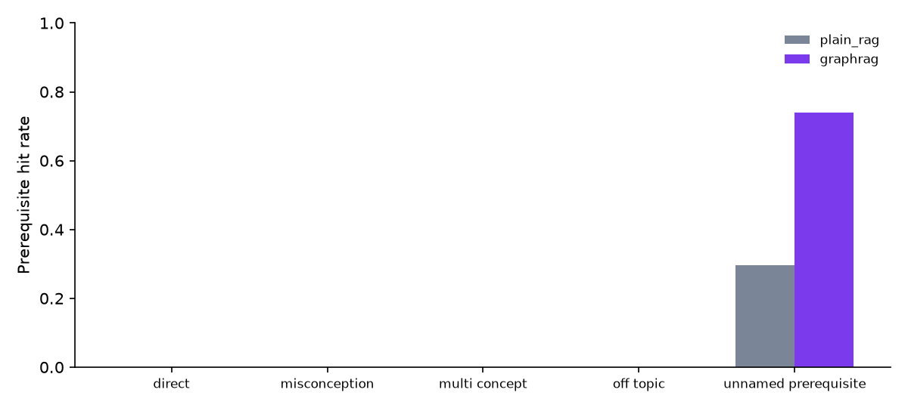
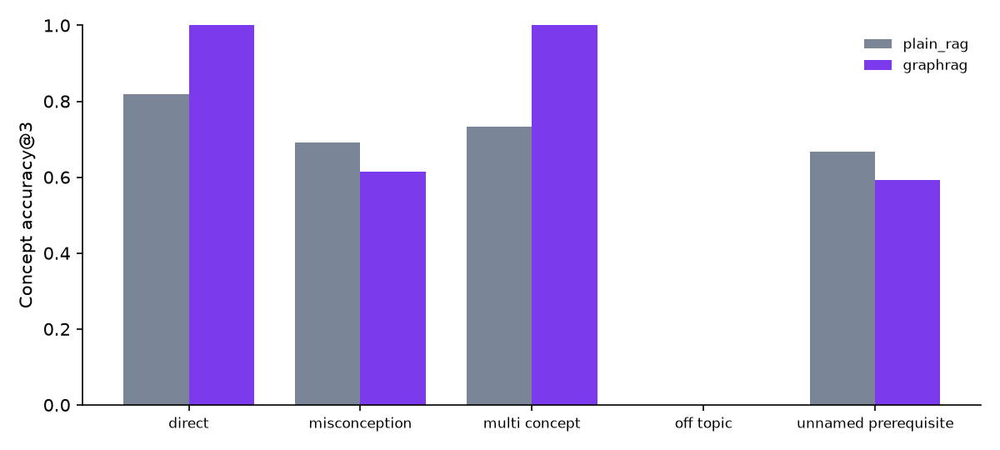

# Evaluation run `fake-offline-full`

Generated 2026-11-20T06:51:07+00:00 by `evaluation/ragas_eval.py`.

- Retrieval source: offline (in-memory graph and vectors from the source files)
- Answer model: fake:fake-model; embeddings: fake-embedding (dim 768)
- Items: 85 (each through GraphRAG and plain RAG, response cache off, agentic step off)
- RAGAs: not run: the judge is the offline fake model (set LLM_JUDGE_PROVIDER)

> **Fake mode.** The answer model is the offline FakeProvider, so answer-quality numbers are not meaningful; retrieval metrics (prerequisite hit rate, concept accuracy) are. Re-run with real keys for the report's final numbers (Human Action Needed).

## Headline: `unnamed_prerequisite` items

| Category | Mode | n | Prereq hit | Concept@1 | Concept@3 | Latency ms | Tokens |
|---|---|---|---|---|---|---|---|
| unnamed_prerequisite | graphrag | 27 | 0.74 | 0.41 | 0.59 | 16 | 9517 |
| unnamed_prerequisite | plain_rag | 27 | 0.30 | 0.30 | 0.67 | 175 | 2194 |

Paired comparison on the same items (GraphRAG minus plain RAG):

| Metric | Pairs | Plain RAG | GraphRAG | Δ mean | 95 % CI | Wilcoxon p | Rank-biserial r |
|---|---|---|---|---|---|---|---|
| prerequisite_hit | 27 | 0.30 | 0.74 | +0.44 | [+0.19, +0.67] | 0.0027 | +0.75 |
| concept_hit_at_3 | 27 | 0.67 | 0.59 | -0.07 | [-0.30, +0.15] | 0.527 | -0.20 |

## All items by mode

| Category | Mode | n | Prereq hit | Concept@1 | Concept@3 | Off-topic decline | Latency ms | Tokens |
|---|---|---|---|---|---|---|---|---|
| all | graphrag | 85 | 0.74 | 0.65 | 0.79 | 0.88 | 11 | 9139 |
| all | plain_rag | 85 | 0.30 | 0.47 | 0.73 | 0.00 | 183 | 2100 |

Paired comparison, all items:

| Metric | Pairs | Plain RAG | GraphRAG | Δ mean | 95 % CI | Wilcoxon p | Rank-biserial r |
|---|---|---|---|---|---|---|---|
| prerequisite_hit | 27 | 0.30 | 0.74 | +0.44 | [+0.19, +0.67] | 0.0027 | +0.75 |
| concept_hit_at_3 | 77 | 0.73 | 0.79 | +0.06 | [-0.06, +0.19] | 0.317 | +0.20 |

## By category

| Category | Mode | n | Prereq hit | Concept@1 | Concept@3 | Off-topic decline | Latency ms | Tokens |
|---|---|---|---|---|---|---|---|---|
| direct | graphrag | 22 | — | 0.95 | 1.00 | — | 8.27 | 9377 |
| direct | plain_rag | 22 | — | 0.68 | 0.82 | — | 197 | 1910 |
| misconception | graphrag | 13 | — | 0.23 | 0.62 | — | 12 | 9099 |
| misconception | plain_rag | 13 | — | 0.46 | 0.69 | — | 171 | 2140 |
| multi_concept | graphrag | 15 | — | 1.00 | 1.00 | — | 10 | 9805 |
| multi_concept | plain_rag | 15 | — | 0.47 | 0.73 | — | 189 | 2041 |
| off_topic | graphrag | 8 | — | — | — | 0.88 | 5.62 | 6022 |
| off_topic | plain_rag | 8 | — | — | — | 0.00 | 183 | 2355 |
| unnamed_prerequisite | graphrag | 27 | 0.74 | 0.41 | 0.59 | — | 16 | 9517 |
| unnamed_prerequisite | plain_rag | 27 | 0.30 | 0.30 | 0.67 | — | 175 | 2194 |

## How to read this

- **Prereq hit** = share of items whose retrieved context contains at least one chunk from every gold prerequisite (the project's central claim; only items with gold prerequisites).
- **Concept@k** = a gold concept is among the first k classified concepts (GraphRAG) or the concepts of the first k chunks (plain RAG).
- Wilcoxon signed-rank (two-sided, normal approximation), effect size = matched-pairs rank-biserial r, 95 % CI = percentile bootstrap of the mean paired difference.
- The numbers are reported as they came out; nothing is filtered.
